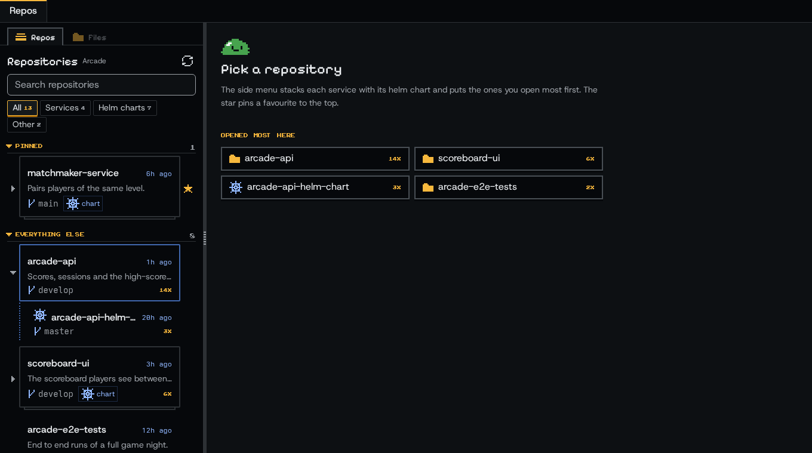
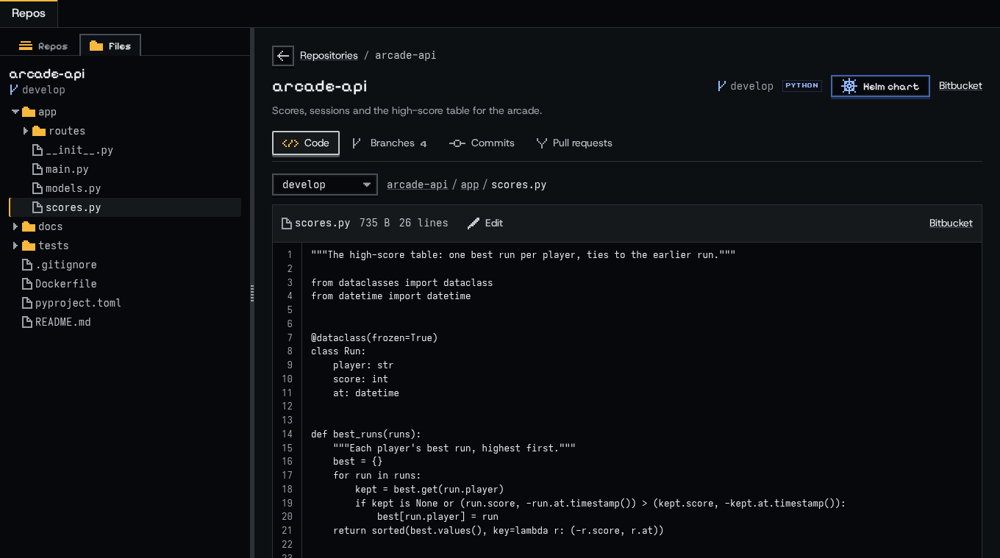
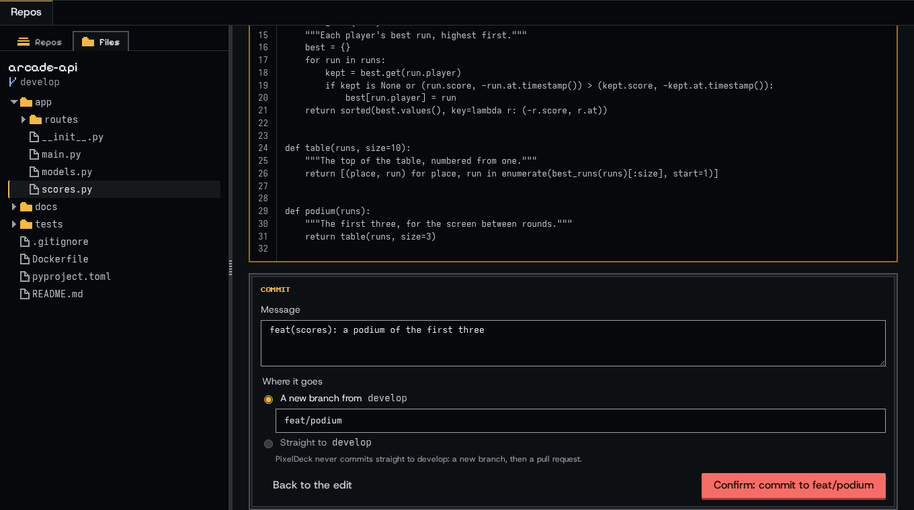

<p align="center">
  
</p>

<h1 align="center">PixelDeck</h1>

<p align="center">
  A retro desk for your Bitbucket Cloud pull requests, with Claude Code running next to the diff.
</p>

PixelDeck is a small local app. It shows the pull requests that need you, the diffs and review
threads, your team's queue and merge history, and a built-in terminal where Claude Code can fix
review comments on the right branch. It looks and moves like an 8-bit game, and gets out of the
way when you want it to.

Full documentation, with the architecture, security model and measured performance:
[docs/pixeldeck-documentation.html](docs/pixeldeck-documentation.html) (open it in a browser).

## What it does

- **Queue.** Your pull requests by state: needs you, changes requested, open, waiting, approved,
  waiting for your review, pushed without a pull request, merged and declined. A date filter
  (today, 7 days, 30 days, or a range) narrows any list by when it was opened, merged or
  declined. A colour-coded merge tree shows what branched off and came back.
- **Pull request view.** Overview with the description rendered from Markdown, the diff with
  per-file "viewed" marks, threads, commits and tasks. The header folds away so the diff gets the room.
  **Copy link** puts the pull request's address on the clipboard in one click.
- **Copy review comments.** One click copies every thread (or the open ones, or one thread) as
  plain Markdown, ready to paste into a Claude prompt.
- **Claude Code on a pull request.** Fix, Fix and push, Read and summarize, or Review. PixelDeck
  prepares a worktree on the branch, briefs Claude with the open threads (quoted as data, never as
  instructions) and starts it in the built-in terminal. The brief comes from templates you can
  replace with your own.
- **A menu bar for a title bar.** Desk, View, Go, Pull request, Team and Help gather what
  PixelDeck does; Alt and the underlined letter opens one. One chip picks the project and the
  person, and Jump (Ctrl K), in the middle of the bar, finds any pull request by number, title,
  ticket or branch, any terminal, repository, teammate or menu command, and songs, albums,
  artists and playlists on Spotify (# $ @ > ! narrow it to one kind). In the PixelDeck window
  the bar replaces the system title bar:
  drag its empty parts to move the window, double-click to maximize, and its own buttons
  minimize, maximize and close (Personalise brings the system title bar back).
- **One Pull Requests panel.** The queue's side menu sits on the left; a pull request opens in
  the list's place beside it, and a section click or Back to the queue returns to the list.
  The status line under its title says who approved, whether the branch is up to date with its
  target and what is still open. Merge is green once nothing waits and yellow while a review or
  a sync is due; after a Sync the branch reads as up to date at once.
- **Claude comes back as it ran.** A Claude Code terminal started with
  --dangerously-skip-permissions (or a --permission-mode) is resumed with the same flag, and the
  restore popup lets you choose.
- **Pick up where you left off.** PixelDeck keeps the open terminals every few seconds and when it
  stops. At the next start a popup offers them back: shells in their folders with their last
  screen, Claude Code resumed by its session id. The layout, theme and terminal names are kept
  on the server too, so they come back even when the window was closed abruptly.
- **Terminal panel.** Real shells in tabs, drawn with WebGL for smooth scrolling. Tabs are named
  after what runs in them, can be renamed and dragged into any order, and show a small loader
  while something is working in them. Drop files on a terminal to paste their paths. The shells
  stay alive after you close the window, and reopening it brings their screens back as they were.
  Web addresses in a terminal are links: a click asks first, then opens your browser or copies it.
- **Pull requests an agent asks to open.** Instead of opening a pull request itself, an agent
  such as Claude Code runs `pixeldeck.py --propose` and waits. A notification shows the branch,
  its target and its size: **Proceed** opens it as proposed, **Review** opens the popup (target
  branch, close the branch after the merge, the diff), **Decline** says no. See below.
- **Notifications.** Each refresh is compared with the last one: a pull request opened, an
  approval, changes asked, new comments, a review asked of you, a merge or a decline. News spins
  in as a slot machine banner (one per burst, with a count) and lands behind the bell with its
  history. Silence it per kind, keep only your own pull requests, or snooze it. Your own actions
  never notify you.
  When a merge into its target leaves one of your branches behind, you hear it at once (one call
  per open pull request of yours every 3 minutes) with a Sync button, like Bitbucket's; approvals
  taken back and new tasks notify too, and every kind is on by default.
- **Status bar.** The main things only: when your pull requests were read and the next read, the
  connection, the music player, your apps, the bell and refresh. Bitbucket API calls left this
  hour are in the sync tooltip; the API meter is a quick toggle and shows itself when they run low.
- **Control center.** The bell has two tabs: your notifications, and quick toggles (Spotify sync,
  do not disturb, lyrics, the mini player, apps in the bar, the API meter, mascots, calm motion,
  games). Edit lets you drag the tiles into your order, pin any of them to the bar with ☆, and pick
  a grid, compact or list layout. Each app icon (Bitbucket, Jira, Spotify, Claude Code) sits in the
  bar or in the control center: drag it from one to the other, or use × and ↑. All of it is kept
  with your other settings.
- **Welcome.** The first start says "Welcome" in eight languages (English, French, Tunisian,
  German, Japanese, Russian, Portuguese, Spanish), drawn in pixels, until you insert a coin (a
  click or any key). Five short stages follow: the crew (the blue bot is your agent, the blob is
  your AI helper), where your code lives, your tools, your look, and press start. SKIP leaves at
  any moment; **Help, Welcome** plays it again.
- **Lock screen.** Lock the computer (Super+L, Windows+L) and come back to "Let's code" in eight
  languages, with a new line each time to get you going. Optional 4 to 8 digit passcode, sounds
  you can switch off on the screen itself, and **Desk, Lock PixelDeck** on demand. On Linux
  PixelDeck hears the lock from the desktop (GNOME, KDE and others on the session bus). The
  passcode is a privacy screen for the window, not a second lock on the computer; only a salted
  hash is kept, and `pixeldeck.py --forget-passcode` removes it.
- **Connected apps.** Settings lists what PixelDeck connects to, grouped (where your code lives,
  AI helpers, tickets, music and video), each with an 8-bit icon and its state. A click opens its
  guide: the steps, each with the link to the exact page, then the fields to paste into. Jira and
  Spotify are set up there without editing a file. The same guides are below, in
  [Setup guides](#setup-guides).
- **Themes and accents.** Two dark themes (Night, the default, and Midnight) and two light ones
  (Daylight, a warm grey, and Retro grey), with six accent colours apart. The blue bot, joystick on
  its head, is the same in every theme; the blob, the AI helper, takes each theme's colour, and has
  a word about its CSS if you hover it after a change. Terminals stay dark in every theme.
- **Settings.** What PixelDeck is connected to (Bitbucket, Jira, the Claude Code CLI, git and
  terminals), what notifies you, and your look: accent colour, number font and size, motion,
  mascots.
- **Team and insights.** Your teammates' queues, review load and merge history. Insights pick a
  range, from 7 days to 120; a month or less is charted per day.
- **Repos.** A tab beside the queue, split into a side menu and a pane: the project's repositories
  with a search and a filter (services, helm charts, other), each service stacked with its helm
  chart, the ones you open most and the pinned ones first; the open repository's file tree; and
  for each one its code at any branch (folders, files with line numbers, the README), its branches,
  its recent commits and its open pull requests. A helm button jumps between a service and its
  chart. Code and commits are kept once read, so going back costs no API calls. A text file can
  be edited and committed to a new branch (never straight to main, master or develop), then
  opened as a pull request; that needs repository write on the token.
- **Panel copies.** Copy the Queue or Insights panel: each copy keeps its own person, section
  and range, so two people or two ranges sit side by side. Copies are saved with the layout and
  open in their own window too.
- **Reviews.** Approve or request changes on a teammate's open pull request, and take either
  back, from the pull request's toolbar.
- **Actions.** Open a pull request from a pushed branch; sync, merge or decline your own pull
  request; delete a pushed branch. Each asks for a second click in place. When your branch is behind its
  target, a bar says by how much and offers **Sync now**, like Bitbucket's.
- **Merge popup.** Like Bitbucket's: the strategies the target branch allows (merge commit,
  squash, fast forward and the rebase ones, its default picked), the commit message Bitbucket
  would write, closing the branch, and the ticket from Jira with its status. Pick the status it
  should move to and PixelDeck moves it once the merge is through (needs `JIRA_TOKEN`).
- **Arcade layer.** A title screen while it loads, pixel sprites, and small game moments for
  merges, deletions and new shells. Two mascots: the green slime does AI work (it comes when you
  start Claude and builds its terminal tab), the blue bot does PixelDeck's own work (it stands by
  a button while a merge, sync, decline or delete runs) and its eyes follow your pointer. They
  race each other along the loading bar. Menus unfold in a few pixel steps and their items
  tick in one after another. Reduced motion, or Calm in the settings, turns the motion off.
- **Arcade dock.** Tetris, Snake and Flappy, played with the slime and the bot, open beside the
  terminal from the Layout menu. While one of your pull requests waits on reviewers or on its
  merge, the bot on the terminal bar now and then suggests a round, with a line it has not said
  lately. It never takes focus from a terminal; switch it off in the Layout menu.
- **Music.** A retro boombox for Spotify: pixelated album art, a green LCD with the title
  scrolling, a block progress bar to seek, chunky transport keys, volume blocks, an equalizer,
  your devices and your playlists as cassettes; a mini player sits in the status bar. Spotify
  sync (the SYNC key or a quick toggle) stops PixelDeck asking Spotify what plays until you turn
  it back on; playing something from here turns it on again. It drives
  your own Spotify app (desktop or phone) through Spotify's Web API. Each person uses their own
  Spotify app, see below. **Preview** in the player shows it with made-up music.
- **Lyrics.** The LYRICS key puts the song's lyrics beside the deck, from
  [LRCLIB](https://lrclib.net), a free and open lyrics database (Spotify's API has none). Timed
  lyrics follow the song and a click on a line jumps there; the small player has a LYRICS tab.
  Only the song's title, artist, album and length are sent to lrclib.net, while the lyrics are
  open, and answers are kept so a replay asks nothing.
- **Devices.** PLAY ON shows the device playing with a picture of its kind (computer, phone,
  speaker, TV, car, console) and lists the others; a pick moves the music there. The status
  bar names the device when the music plays somewhere other than this computer.
- **Many terminals.** The tab strip scrolls with the wheel and its arrows, with no scrollbar over
  the names; long names are cut (the tooltip has them whole), and the list beside the strip finds
  any terminal by name.
- **Guide.** A short tour on the first start, a spotlight on each part with a mascot telling it.
  The **?** in the status bar brings it back.


## A look around

The Repos panel, with made-up data: each service stacked with its helm chart, the pinned and
the most opened first.



A repository open: its file tree on the side, the file on the right, and the helm button that
jumps to its chart.



Edit a file and commit it to a new branch. The second click commits; PixelDeck never writes
straight to main, master or develop.



## Requirements

| | Linux | macOS | Windows |
|---|---|---|---|
| Python 3.10 or newer (tested on 3.12 and 3.14) | yes | yes | yes |
| git on PATH | yes | yes | yes |
| Claude Code CLI | optional, for the Claude actions | optional | optional |
| App window | its own GTK window when PyGObject, GTK 4 and WebKitGTK 6 are installed; otherwise Chrome, Chromium, Edge or Brave in app mode | Chrome, Edge or Brave in app mode, else the default browser | Edge (built in) in app mode |
| Terminal panel | built in | built in | `py -m pip install pywinpty` |

The server uses the Python standard library only. The one extra package is `pywinpty`, on
Windows, for the terminal panel. You also need a Bitbucket Cloud account and an API token.

**Platform status.** PixelDeck is developed and tested on Linux (Fedora, GNOME on Wayland).
It also runs on Windows 11, from a git clone and as the packaged app below. The macOS code
paths are written and covered by import tests that pretend to be that system, but they have
not run on a real Mac yet. Reports and fixes are welcome.

## Windows installer

`PixelDeck-Setup-<version>-x64.exe` installs PixelDeck without Python, git clone or `.env`.
Nothing is published yet: build it with `packaging/build.py` (see Development).

- **Install.** Run it. No administrator rights: it goes into
  `%LOCALAPPDATA%\Programs\PixelDeck`. It offers a Start menu entry, a desktop icon and the
  `pixeldeck` command on PATH (for `pixeldeck --stop`, `--status` and an agent's
  `pixeldeck --propose`). It is not signed yet, so Windows SmartScreen warns on the first run:
  More info, then Run anyway.
- **First start.** Settings opens on Setup: your Atlassian email, the API token, the
  workspace and the folder that holds your clones. **Check** tries each Bitbucket endpoint
  PixelDeck reads and names any scope the token lacks. **Save** puts the token in Windows
  Credential Manager and the rest in `%APPDATA%\PixelDeck\.env`. Used PixelDeck from a git
  clone before? **Import** copies that clone's `.env`, token included.
- **Update.** Run the new Setup. It stops the server first, and refuses while terminals are
  open or an agent waits on a proposal, since a stop would end them.
- **Uninstall.** From Settings, Apps. It asks whether to remove your settings and token too;
  the answer is no unless you say yes.

The installed app and a git clone share the port (8642) and the settings folders, so run one
at a time.

## macOS and Linux packages (untested)

The code to build them is here, but no one has run them yet: the Linux package is waiting for
a test on Fedora, and the macOS one for someone with a Mac. Until then, use a git clone (Quick
start).

- **Linux:** `PixelDeck-<version>-x86_64.AppImage`, and the same app as a `.tar.gz`.
  - Mark the AppImage executable and run it.
  - Settings, About, "On this computer" adds PixelDeck to the app menu and installs the
    `pixeldeck` command in `~/.local/bin`. If you move the AppImage later, it says so and
    offers Fix.
  - The token goes to the system keyring (GNOME Keyring, KWallet 6) through `secret-tool`. When
    there is none, it stays in `~/.config/pixeldeck/.env`.
- **macOS:** `PixelDeck-<version>-arm64.dmg` (Apple Silicon) or `-x64.dmg` (Intel).
  - Drag PixelDeck to Applications.
  - It is not signed, so macOS refuses the first open: in System Settings, Privacy & Security,
    click Open Anyway.
  - About installs the `pixeldeck` command. The token goes to the login Keychain.
  - Settings stay in `~/Library/Application Support/PixelDeck` after you drag the app to the
    Bin.
- **Both:** started from the Dock or an app menu, the server reads your login shell's PATH, so
  it finds `claude` and `git` where your terminal does.

## Quick start

```sh
git clone https://github.com/ahmedloumx/pixeldeck.git
cd pixeldeck
cp .env.example .env        # Windows: copy .env.example .env
```

Edit `.env` and set at least `BITBUCKET_EMAIL`, `BITBUCKET_TOKEN` and `BITBUCKET_WORKSPACE`, and
`PIXELDECK_WORKSPACE_ROOT` (the folder that holds your clones). Then start it:

| | Start | Stop |
|---|---|---|
| Linux | `python3 pixeldeck.py` or `./run.sh` | `python3 pixeldeck.py --stop` |
| macOS | double-click `PixelDeck.command`, or `python3 pixeldeck.py` | `python3 pixeldeck.py --stop` |
| Windows | double-click `PixelDeck.cmd`, or `py pixeldeck.py` | `py pixeldeck.py --stop` |

On Linux, `./install-desktop.sh` adds PixelDeck to the app grid and pins it to the GNOME dock.

Closing the window leaves the server and its terminals running, so a Claude run is never cut
off. `--status` tells you whether it runs; `--server` runs the server in the console for debugging.

After an update (`git pull`), start PixelDeck again: the server still runs the code from before,
and the launcher restarts it. It does not while terminals are open, since a stop ends them; the
page then says the server is out of date, and `--stop` followed by a start finishes the update.

### The API token

Create an Atlassian API token with Bitbucket scopes at
<https://id.atlassian.com/manage-profile/security/api-tokens>. Give it the least it needs:
read access to your user, the workspace, repositories and pull requests, plus pull request write
if you want to open, merge and decline pull requests from PixelDeck, and repository write if you want
to commit a file edited in the Repos panel. Nothing more: PixelDeck never needs
admin or delete scopes. Deleting a pushed branch and the Claude fixes go through git with your own
git credentials, not through the token.

From a git clone the token lives in `.env`, which `.gitignore` keeps out of git. Saved from the
setup screen (Settings, Setup) on Windows, it goes to Windows Credential Manager instead, and
out of the file. PixelDeck sends it to `api.bitbucket.org` and nowhere else.

## Setup guides

The same steps as in **Settings, Connected apps**, where each app has a card: green when it
works, yellow when it needs you, grey when it is not connected. A click opens its guide.

### Set up Bitbucket

1. Open [id.atlassian.com, Security, API tokens](https://id.atlassian.com/manage-profile/security/api-tokens)
   and press **Create API token with scopes**.
2. Pick the app **Bitbucket** and tick `read:user:bitbucket`, `read:workspace:bitbucket`,
   `read:repository:bitbucket` and `read:pullrequest:bitbucket`. Add `write:pullrequest:bitbucket`
   to open, merge and decline pull requests from PixelDeck (see [The API token](#the-api-token)).
3. In **Settings, Setup**, paste it with your Atlassian email and your workspace (the part after
   `bitbucket.org/`), press **Check**, then **Save**.

### Set up git

1. Install git from [git-scm.com/downloads](https://git-scm.com/downloads).
2. In **Settings, Setup**, point **Your clones** at the folder that holds your repositories.

### Set up Claude Code

1. Install Claude Code: [docs.claude.com, Claude Code](https://docs.claude.com/en/docs/claude-code/overview).
2. Run `claude` once in a terminal and sign in.
3. Not on your PATH? Put its full path in `PIXELDECK_CLAUDE` in the settings file.

### Set up Jira

1. Open [id.atlassian.com, Security, API tokens](https://id.atlassian.com/manage-profile/security/api-tokens),
   signed in as the account you use for Jira.
2. Press **Create API token**, name it PixelDeck, and copy it.
3. In **Settings, Connected apps, Jira**, paste it with your Jira address
   (`https://your-team.atlassian.net`) and press **Save and test**. Leave the email empty when it
   is your Bitbucket one.

### Set up Spotify

1. Open [developer.spotify.com/dashboard](https://developer.spotify.com/dashboard), create an app
   (any name) and tick **Web API**.
2. Add the redirect URI `http://127.0.0.1:8642/spotify/callback` to it (your port, if you
   changed `PIXELDECK_PORT`). The guide shows it with a copy button.
3. Paste the app's **Client ID** in **Settings, Connected apps, Spotify** (or in the Music panel's
   setup) and save it, then press **Connect** and sign in to Spotify. More in
   [The music player and your Spotify app](#the-music-player-and-your-spotify-app).

## Configuration

Everything is in one settings file; [.env.example](.env.example) lists every key with a comment.
A git clone uses the `.env` next to the code. The packaged app, or a clone without one, uses
`.env` in the config folder: `%APPDATA%\PixelDeck`, `~/Library/Application Support/PixelDeck`
or `~/.config/pixeldeck`. `PIXELDECK_ENV` names another file. A value in the real environment
wins over the file, the file wins over Windows Credential Manager (for `BITBUCKET_TOKEN` and
`JIRA_TOKEN` only), and the file is re-read when it changes.

| Key | What it is |
|---|---|
| `BITBUCKET_EMAIL`, `BITBUCKET_TOKEN` | Your Atlassian account email and API token. Required. |
| `BITBUCKET_WORKSPACE` | The workspace slug, as in `bitbucket.org/<workspace>/<repo>`. Required. |
| `BITBUCKET_PROJECT` | Start scoped to one project key. Empty: every project. |
| `JIRA_SITE`, `TICKET_PREFIXES` | Turn ticket keys such as `ABC-123` in branches and titles into Jira links. |
| `SPOTIFY_CLIENT_ID` | The Client ID of your own Spotify app, for the music player (see below). |
| `JIRA_TOKEN`, `JIRA_EMAIL` | An Atlassian API token with Jira access, to show and move a ticket's status in the merge popup. Classic and scoped tokens both work; the Bitbucket token is never sent to Jira. `JIRA_EMAIL` defaults to `BITBUCKET_EMAIL`. **Settings, Connected apps, Jira** sets all three without editing the file, and tries them at once; the token is never shown back. |
| `SPOTIFYD`, `SPOTIFYD_PATH`, `SPOTIFYD_DEVICE_NAME` | PixelDeck's own Spotify player (see below): `SPOTIFYD=off` turns it off, `SPOTIFYD_PATH` names the program when it is not on the PATH or in `~/.local/bin`, the device name defaults to `PixelDeck`. |
| `PIXELDECK_WORKSPACE_ROOT` | The folder with your local clones. Default: the folder PixelDeck sits in. |
| `PIXELDECK_RELEASE_REPOS` | Glob patterns of repos whose pull requests target master or main before develop. |
| `PIXELDECK_BRIEFS_DIR` | Your own Claude brief templates (see below). |
| `PIXELDECK_CLAUDE` | Path to the `claude` CLI when it is not on PATH. |
| `PIXELDECK_BROWSER` | A command for opening links, for example `firefox --new-tab`. Default: the system browser. |
| `PIXELDECK_PORT` | The local port. Default 8642. |
| `PIXELDECK_CACHE_DIR`, `_STATE_DIR`, `_DATA_DIR`, `_CONFIG_DIR`, `PIXELDECK_SETTINGS_FILE` | Move where PixelDeck keeps its files. |

### Letting an agent open pull requests through you

```sh
python3 pixeldeck.py --propose --repo shop-api --branch feat/ABC-12-cart \
    --title "feat: cart totals (ABC-12)" --description-file pr.md
```

With the packaged app the command is `pixeldeck --propose ...`, with the same options.

The command waits up to 100 seconds (`--wait` to change it) and then exits with **0** and the
pull request's link when you open it, **2** if you declined, **3** if you have not answered yet
(run the same command again: it picks up the same proposal), or **4** if PixelDeck is not
running. `--dest` picks another target branch and `--keep-branch` keeps the branch after the
merge. Approval is refused if the branch moved since it was proposed, so what opens is what you
saw. Put a line in your agent's instructions (for Claude Code, its `CLAUDE.md`) telling it to
open pull requests this way.

### The music player and your Spotify app

Spotify gives each app its own Client ID, so everyone who runs PixelDeck uses an app of their own:

1. At [developer.spotify.com/dashboard](https://developer.spotify.com/dashboard), create an app
   (any name) and tick **Web API**.
2. Add the redirect URI `http://127.0.0.1:8642/spotify/callback` (your port, if you changed
   `PIXELDECK_PORT`). Spotify allows plain http only for `127.0.0.1`, never `localhost`.
3. Paste the app's Client ID in **Settings, Connected apps, Spotify** and save it (it lands in the
   settings file as `SPOTIFY_CLIENT_ID=`). No client secret: PixelDeck signs in with PKCE, the flow
   made for apps that cannot keep one.
4. Press **Connect** in the Music panel and sign in to Spotify in your browser.

Spotify Premium is needed for the app's owner (in development mode) and for play, pause, skip,
seek and volume. In development mode an app works for its owner and up to 5 people added under
User Management. The player shows the exact redirect URI to register, with a copy button.

#### Music without the Spotify app

Spotify's Web API only steers a Spotify app that is open somewhere. To play with none open,
install [spotifyd](https://github.com/Spotifyd/spotifyd), a small open-source Spotify Connect
player (not made by Spotify; Premium needed): the Linux file ending in `x86_64-full.tar.gz` from
its releases, with `spotifyd` put in `~/.local/bin`. Then press **Sign in to Spotify** under
**Settings, Connected apps, Spotify**: Spotify's own login page opens in your browser, and the login
is kept in PixelDeck's state folder, readable by you only. From then on PixelDeck starts it with
the server, as the device **PixelDeck** playing through this computer's speakers, restarts it if
it stops, and stops it with the server. It never announces itself on the network, so nobody on
the same Wi-Fi can take it over.

### Claude brief templates

The text Claude receives is built from `briefs/head.md` plus one of `summarize.md`, `review.md`,
`fix.md` and `fix_push.md`. To use your own house rules (a review rubric, commit conventions),
copy any of them to a folder of your own, edit them, and set `PIXELDECK_BRIEFS_DIR` to that
folder. Files you leave out come from `briefs/`. Placeholders such as `{source}`, `{dest}`,
`{cwd}` and `{ticket}` are filled in; the open threads are appended after the template.

## Security

- The server listens on `127.0.0.1` only, refuses other Host and Origin headers, and requires a
  secret, made at each start, on every API call. Another website open in your browser cannot drive it.
- Pull request text is untrusted: descriptions and comments are rendered by an escape-first
  Markdown renderer that only builds a fixed set of tags, and the Claude brief fences reviewer
  text as data. Tests feed both hostile input.
- Destructive actions ask for a second click in place (an agent's proposal needs your one click
  on Proceed). Merge and decline work only on your own open pull
  requests. A merge re-reads the pull request first, and Bitbucket's own merge checks still
  decide. Protected branches are never deleted, and a deleted branch is logged with the command
  that restores it.
- The propose key an agent uses can only ask and read the answer; only the page can approve.
  That makes the approval a cooperative step, not a barrier: any program running as you can
  reach PixelDeck, and your `.env`, anyway.
- Fix and push tells Claude to push with `--force-with-lease` on the exact remote commit. That
  is an instruction to Claude, not a check PixelDeck enforces.
- The settings report says whether a token is set and where the settings file is, never the
  token. The Jira site comes from `.env` only, never from the page, and a ticket key must look
  like one before it reaches a URL.
- The routes the page polls (events, status) answer from memory and never call Bitbucket.
- The Repos panel checks every repository, commit and path before it reaches a URL; file
  contents are shown as text, never as markup. Its one write commits one edited file: a second
  click, never straight to main, master, develop or the repository's main branch, and always
  with its branch and the commit it was opened at, so a branch that moved since is refused.
  Only text shown whole is saved: UTF-8, its line endings kept, up to 512 KB, not executable
  and not a link.
- Spotify tokens stay on the server, in the state folder with mode 600, and never reach the page
  or a log. The sign-in comes back to `/spotify/callback` with a single-use state that expires in
  10 minutes; album art is fetched by the server from Spotify's image host only.

## Development

```sh
python3 -m unittest discover -s tests
```

There is no build step: the page is plain HTML, CSS and JavaScript in `static/`, read from disk
on every request, so a reload shows a change. The documentation describes each file.

The installers are the one thing that is built. `packaging/build.py` builds the package for
the system it runs on, with Python 3.10 or newer:

| System | Once | Builds |
|---|---|---|
| Windows | `py -3 -m pip install pyinstaller pywinpty`, and [Inno Setup 6](https://jrsoftware.org/isinfo.php) (or set `ISCC`) | `dist/PixelDeck-Setup-<version>-x64.exe` |
| Linux (untested) | `python3 -m pip install pyinstaller`, and [appimagetool](https://github.com/AppImage/appimagetool/releases) on PATH (or set `APPIMAGETOOL`) | `dist/PixelDeck-<version>-x86_64.AppImage` and a `.tar.gz` |
| macOS (untested) | `python3 -m pip install pyinstaller` | `dist/PixelDeck-<version>-arm64.dmg` (or `-x64` on Intel) |

```sh
python3 packaging/build.py            # py -3 on Windows; --app-only stops after the app folder
```

It prints each file's size and SHA-256. Without appimagetool, Linux still gets the `.tar.gz`.
The version is the `v*` tag on the commit, else `VERSION` in `version.py`.

`packaging/pixeldeck.spec` builds one folder with the program `pixeldeck`: the launcher, the
`pixeldeck --stop` and `--propose` command, and the server itself (`pixeldeck --server`).
Windows adds `pixeldeckw.exe`, the same without a console, for the Start menu. macOS wraps the
folder in `PixelDeck.app`. In an AppImage, the server starts through the AppImage file again,
because the launcher's own mount, and the files on it, go away when the launcher exits.

The plans: [installer-and-updates.md](docs/installer-and-updates.md),
[packaging-macos-linux.md](docs/packaging-macos-linux.md),
[release-pipeline.md](docs/release-pipeline.md) and
[integration-setup.md](docs/integration-setup.md).

## Credits

- [xterm.js](https://xtermjs.org/) and its fit, WebGL, Unicode 11 and serialize add-ons, MIT license.
- Fonts: Press Start 2P, Pixelify Sans and Host Grotesk, SIL Open Font License 1.1.
- The Arcade number font is ArcadeClassic by Pizzadude when it is installed on your computer. Its
  license allows personal use only, so PixelDeck does not ship it; without it, Press Start 2P
  stands in.

Their license texts are in [licenses/](licenses/).

PixelDeck is an independent project. It is not affiliated with or endorsed by Atlassian or
Anthropic. Bitbucket and Jira are trademarks of Atlassian; Claude and Claude Code are
trademarks of Anthropic.

## Contributing

`main` holds the released version and `develop` the next one. Open pull requests against
`develop`; see [CONTRIBUTING.md](CONTRIBUTING.md).

## License

[MIT](LICENSE)
